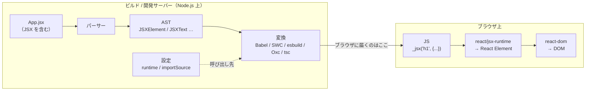

React のコンポーネントには、こんなコードを書きます。

```jsx
return <h1 className="title">Hello, {name}!</h1>;
```

見た目はほとんど HTML です。でも、よく見ると HTML ではありません。React の JSX では、属性は `class` ではなく `className` ですし、`{name}` のように JavaScript の式がそのまま埋め込まれています。かといって、JavaScript にも `return` の後ろにタグを書く構文はありません。

では、ブラウザはこのタグを HTML として読んでいるのでしょうか。それとも JavaScript として読んでいるのでしょうか。

答えはどちらでもありません。ブラウザに届く時点で、このタグはもう残っていないからです。筆者も「ビルドのときに何かに変換されている」ことは知っていました。ただ、何に変換されて、ブラウザが最終的に何を受け取っているのかは説明できませんでした。この記事では、変換の途中でできるもの（中間生成物）を 1 つずつ取り出しながら、`.jsx` に書いたタグが JavaScript になり、実行されて何を返すのかまでを追いかけます。

## この記事の前提

- 環境: React 19.3.1 / react-dom 19.3.1 / Node.js v26.12.1 / macOS
- ブラウザでの確認: Vite 8.3.5（`@vitejs/plugin-react` 6.1.2）/ Google Chrome 156.0.8078.80
- 変換ツール: Babel（`@babel/core` 8.0.9・`@babel/preset-react` 8.0.1・`@babel/parser` 8.0.8）を主に使い、比較用に TypeScript 7.0.2 の tsc / SWC（`@swc/core` 1.16.20）/ esbuild 0.28.2 / Oxc（`oxc-transform` 0.156.0）も使います。TSX のコラムでは、ほかに `@babel/preset-typescript` 8.0.7・`@babel/plugin-syntax-typescript` 8.0.3・`@types/react` 19.3.0 を使います
- 対象: React の標準の変換方式（automatic runtime）。断りがない限り、開発用の出力（development）はオフにした結果を載せています
- 題材: 小さなコンポーネントを書いた `App.jsx` が中心です。TypeScript（`.tsx`）の場合に何が変わるかは、末尾のコラムで扱います
- 範囲外: 変換後のオブジェクトが Fiber になり DOM に反映される過程（reconcile）、Hooks の実装、Server Components
- 記事中のログ・エラーメッセージ・出力は、すべて筆者が上記環境で実際に採取したものです。AST のダンプと 5 つのツールの比較は、それぞれのツールを Node.js から呼ぶ小さなスクリプトによるものです

## 全体像

- **パーサー** — JSX を構文として読める。ソースを AST（構文木）にし、タグを `JSXElement` などのノードとして表す。各変換ツールが内蔵している（Babel なら `@babel/parser`）
- **変換** — AST の JSX のノードを関数呼び出し（`_jsx(...)`）に書き換え、呼び出し先の import を差し込む。Babel・SWC・esbuild・Oxc・tsc などが担う
- **ランタイム（`react/jsx-runtime`）** — 変換後の `_jsx(...)` の呼び出し先。React Element と呼ばれるただのオブジェクトを返す
- **レンダラー（react-dom）** — React Element を受け取り、ブラウザでは DOM を組み立てる（サーバーでは HTML 文字列にもできる）。この記事では中身には踏み込まない



**ブラウザが受け取っているのは、タグが関数呼び出しに置き換わった普通の JavaScript です。** その JavaScript を実行したあと、react-dom が DOM を組み立てます。

どの関数をどの形で呼ぶかは、JSX の構文自体には決まっていません。React の automatic runtime では、呼ぶのは `react/jsx-runtime` の `jsx(type, props, key)` で、この形は React が定めた約束です。変換ツールは、呼び出し先の設定（importSource など）で指定された先に向けて、この約束どおりに書き換えます。そのため、どの変換ツールを使っても、ほぼ同じ JavaScript になります。

## 課題 — React を書いていて浮かぶ疑問

冒頭の疑問ともう 1 つ、次の 2 つに答えます。

- ブラウザは JSX のタグを HTML として読んでいるのか、JavaScript として読んでいるのか
- JavaScript はスクリプト言語で、書いたファイルをそのまま渡せば動くはずなのに、なぜ React のプロジェクトはデプロイの前にビルドが要るのか

題材は、Fragment（`<>`）・属性・埋め込みの式・イベントハンドラ・`key` が一通り入った小さなコンポーネントです。

```jsx
// App.jsx
import { useState } from "react";

export function App({ name }) {
  const [count, setCount] = useState(0);
  return (
    <>
      <h1 className="title">Hello, {name}!</h1>
      <button onClick={() => setCount(count + 1)}>
        count is {count}
      </button>
      {[1, 2].map((n) => <li key={n}>{n}</li>)}
    </>
  );
}
```

## 試したこと — 中間生成物を段階ごとに取り出す

### 段階 0: JavaScript のエンジンは JSX を読めない

まず、変換をせずにそのまま実行してみます。JSX を含むファイルを `.mjs` として Node.js に渡しました。

```text
$ node stage0/hello.mjs
const el = <h1>hi</h1>;
           ^

SyntaxError: Unexpected token '<'
```

タグの 1 文字目 `<` で構文エラーです。拡張子を `.jsx` にした場合は、プロジェクトの設定で結果が変わりました。package.json が `"type": "module"` なら構文を読む前に `ERR_UNKNOWN_FILE_EXTENSION` で弾かれ、CommonJS なら `.js` として読まれて同じ `SyntaxError` になります。

変換をしない静的なサーバーから、次の HTML を Chrome で開きました。

```html
<script type="module">
  const el = <h1>hi</h1>;
</script>
```

コンソールには、Node.js と同じエラーが出ました。

```text
SyntaxError: Unexpected token '<'
```

JSX は ECMAScript（JavaScript の標準仕様）には入っていない構文拡張です。JSX 自体の仕様の草案（react/jsx、旧 facebook/jsx）も、エンジンやブラウザが実装することは想定していないと冒頭で断っていて、何に変換されるかも定めていません。つまり、ブラウザは JSX を HTML としても JavaScript としても読めません。JSX は、ブラウザに届く前に必ず誰かが JavaScript に変換している構文です。1 つ目の疑問への答えの半分がこれです。

2 つ目の疑問「なぜビルドが要るのか」の答えの中心も、ここにあります。ブラウザに渡す前に JSX を JavaScript へ変換する工程が要り、それを担っているのがビルドです。開発中に同様の変換をしているのは開発サーバーで、その様子は段階 2 の最後で見ます。

### 段階 1: パーサー — タグは JSX 専用のノードになる

最初の仕事は、JSX を読めるパーサーで AST を作ることです。Babel のパーサー（`@babel/parser` に `jsx` プラグインを付けたもの）で、`return (...)` の中身をダンプしました。長いので `<h1>` と `<button>` の部分を抜きます。

```text
JSXFragment
  JSXOpeningFragment
  JSXText "\n      "
  JSXElement
    JSXOpeningElement
      JSXIdentifier "h1"
      JSXAttribute
        JSXIdentifier "className"
        StringLiteral "title"
    JSXText "Hello, "
    JSXExpressionContainer
      Identifier "name"
    JSXText "!"
    JSXClosingElement
      JSXIdentifier "h1"
  JSXText "\n      "
  JSXElement
    JSXOpeningElement
      JSXIdentifier "button"
      JSXAttribute
        JSXIdentifier "onClick"
        JSXExpressionContainer
          ArrowFunctionExpression
          （略）
    JSXText "\n        count is "
    JSXExpressionContainer
      Identifier "count"
    JSXText "\n      "
    JSXClosingElement
      JSXIdentifier "button"
  （以下 map の JSXExpressionContainer）
```

普通の JavaScript の AST には無い、`JSX` で始まるノードが並んでいます。タグ名の `h1` も、JavaScript の識別子を表す `Identifier` ではなく、`JSXIdentifier` という別の種類のノードです。大文字・小文字・ドット付きのタグを並べたファイルでも確かめました。

```jsx
// Main.jsx
import { App } from "./App.jsx";

export const page = <App name="World" />;
export const tag = <app name="World" />;
export const member = <ui.Button />;
```

```text
--- page
JSXElement
  JSXOpeningElement
    JSXIdentifier "App"
    JSXAttribute
      JSXIdentifier "name"
      StringLiteral "World"
--- tag
JSXElement
  JSXOpeningElement
    JSXIdentifier "app"
    （略）
--- member
JSXElement
  JSXOpeningElement
    JSXMemberExpression
      JSXIdentifier "ui"
      JSXIdentifier "Button"
```

Babel のパーサーでは、大文字の `App` も小文字の `app` も同じ `JSXIdentifier` でした。この時点ではまだ「HTML の要素か、自作のコンポーネントか」を区別していません（Oxc のように、パースの時点で区別するパーサーもあります）。

### 段階 2: 変換 — JSX が関数呼び出しになる

`App.jsx` を Babel（`@babel/preset-react`、automatic runtime）で変換し、`dist-jsx/App.js` に書き出しました。

<!-- prettier-ignore -->
```javascript
import { useState } from "react";
import { jsxs as _jsxs, jsx as _jsx, Fragment as _Fragment } from "react/jsx-runtime";
export function App({
  name
}) {
  const [count, setCount] = useState(0);
  return /*#__PURE__*/_jsxs(_Fragment, {
    children: [/*#__PURE__*/_jsxs("h1", {
      className: "title",
      children: ["Hello, ", name, "!"]
    }), /*#__PURE__*/_jsxs("button", {
      onClick: () => setCount(count + 1),
      children: ["count is ", count]
    }), [1, 2].map(n => /*#__PURE__*/_jsx("li", {
      children: n
    }, n))]
  });
}
```

タグが `_jsxs("h1", { className: "title", children: [...] })` という関数呼び出しに書き換わりました。

2 行目の import は、ソースには書いていません。呼び出す関数（`react/jsx-runtime` の `jsx` / `jsxs`）がどこから来るかを書かないと動かないので、変換ツールが自分で差し込んだものです。`_jsx` は、その `jsx` を別名で import したものです。`/*#__PURE__*/` は「戻り値を使っていなければ消してよい」というバンドラ向けの注釈（PURE 注釈）です。

出力には、ほかにも決まりがあります。

- 属性と子は 1 つのオブジェクト（props）にまとめられ、子は `props.children` に入る
- 改行を含む空白だけのテキストを除いて、ソースに書いた子が複数なら `_jsxs`、1 つ以下なら `_jsx` になる
- `key` は props から外れて第 3 引数になる（`_jsx("li", { children: n }, n)`。例外もありますが、ここでは扱いません）

#### 大文字のタグは変数、小文字のタグは文字列

Babel のパーサーでは区別されていなかった大文字と小文字は、変換の段階で分かれます。`Main.jsx` の変換結果です。

<!-- prettier-ignore -->
```javascript
import { App } from "./App.jsx";
import { jsx as _jsx } from "react/jsx-runtime";
export const page = /*#__PURE__*/_jsx(App, {
  name: "World"
});
export const tag = /*#__PURE__*/_jsx("app", {
  name: "World"
});
export const member = /*#__PURE__*/_jsx(ui.Button, {});
```

大文字で始まる `App` は変数 `App` の参照に、小文字の `app` は文字列 `"app"` に、ドット付きの `ui.Button` はプロパティの参照になりました。コンポーネント名を大文字で始めなければいけないのは、このルールで HTML の要素名（文字列）と区別されるからです。

#### 5 つのツールで変換して比べる

実際のプロジェクトで JSX を変換しているのは、Babel だけではありません。Next.js は既定で SWC を使い、Vite 8 では Vite 本体の Oxc が JSX を変換していて、`@vitejs/plugin-react` v6 は Babel への依存をなくしました。そこで、同じ `App.jsx` を Babel・SWC・esbuild・Oxc・tsc の 5 つで変換しました。設定は 3 つそろえています。automatic runtime、importSource は `react`、開発用の出力（development）はオフです。

生の出力は見た目がかなり違います。たとえば esbuild はこうです。

```javascript
import { Fragment, jsx, jsxs } from "react/jsx-runtime";
import { useState } from "react";
function App({ name }) {
  const [count, setCount] = useState(0);
  return /* @__PURE__ */ jsxs(Fragment, { children: [
    /* @__PURE__ */ jsxs("h1", { className: "title", children: [
      "Hello, ",
      name,
      "!"
    ] }),
    /* @__PURE__ */ jsxs("button", { onClick: () => setCount(count + 1), children: [
      "count is ",
      count
    ] }),
    [1, 2].map((n) => /* @__PURE__ */ jsx("li", { children: n }, n))
  ] });
}
export {
  App
};
```

import の順番、`_jsx` か `jsx` かという名前、PURE 注釈の有無と書き方、整形、export の形がツールごとに違います。そこで import 文と PURE 注釈を消し、名前の先頭の `_` と export の形をそろえ、整形し直してから比べるスクリプトを書きました。消した import 文も、import 元は 5 つとも `react/jsx-runtime` で、違うのは並び順と別名だけでした。

```text
App: 1 distinct normalized output(s)

[tsc, babel, swc, esbuild, oxc]
function App({name}){const[count,setCount]=useState(0);return jsxs(Fragment,{children:[jsxs("h1",{className:"title",children:["Hello, ",name,"!"]}),jsxs("button",{onClick:()=>setCount(count+1),children:["count is ",count]}),[1,2].map(n=>jsx("li",{children:n},n))]})}
```

5 つの出力は、書き方の差を除くと完全に一致しました。`Main.jsx` でも同じで、5 つのツールすべてが大文字のタグを変数、小文字のタグを文字列に分けていました。`ui` はどこにも定義していませんが、どのツールもそのまま変換しています。変換ツールは、名前の正体を調べていません。

実装は 5 つともまったく別物で、言語も JavaScript（Babel）・Rust（SWC・Oxc）・Go（esbuild・tsc）とバラバラです。それでも出力がそろうのは、関数の形（`jsx(type, props, key)`）と、そこへの渡し方（子は `props.children` に、`key` は第 3 引数に、子が複数なら `jsxs`）までが React の決めた約束で、どのツールもそれに合わせて書き換えているからです。変換ツールはその約束どおりに呼び出しを書けばよく、他のファイルを見る必要がありません。

なお、開発用の出力をオンにすると、同じ正規化でも 4 通りに分かれました。tsc・SWC・esbuild・Oxc はデバッグ用のソースの位置（ファイル名・行・列）を同じ値で渡しますが、ファイル名を変数に入れるか（tsc は `const`、Oxc は `var`）直接書くか（SWC・esbuild）が違い、Babel 8 は位置の情報そのものを渡しません。

#### ブラウザに届く JavaScript を確かめる

この形のままブラウザに届くことを、実際のプロジェクトでも確かめました。同じ `App.jsx` を Vite 8 のプロジェクトに置き、`vite build` の出力から `App` の部分を抜き出しました。Vite 8 の変換は、先ほどの 5 つのうちの Oxc です。

```javascript
return(0,p.jsxs)(p.Fragment,{children:[(0,p.jsxs)(`h1`,{className:`title`,children:[`Hello, `,e,`!`]}),(0,p.jsxs)(`button`,{onClick:()=>n(t+1),children:[`count is `,t]}),[1,2].map(e=>(0,p.jsx)(`li`,{children:e},e))]})
```

minify（圧縮）で変数名が縮み、文字列の引用符もバッククォートになっています。`p` はバンドルに取り込まれた `react/jsx-runtime` を指す変数で、`(0,p.jsxs)(...)` は `this` を渡さずに `p.jsxs` を呼ぶための、バンドラの書き方です。形は Babel の出力と同じ `jsxs("h1", { className: "title", children: [...] })` で、出力の中に `<h1` という文字列は 1 つもありませんでした。

開発サーバー（`vite`）でも確かめました。Chrome が `App.jsx` を要求すると、`Content-Type: text/javascript` の JavaScript が返ってきます。ブラウザはモジュールとして読み込むファイルの種類を拡張子ではなく `Content-Type` で判断するので、名前が `.jsx` のままでも JavaScript として実行します。中身は開発用の `_jsxDEV(...)`（`react/jsx-dev-runtime`）の呼び出しでしたが、タグが残っていない点は同じでした。あわせて、`import { useState } from "react"` も、`/node_modules/.vite/deps/react.js?v=…` からの import と `const useState = …["useState"]` という形に書き換わっていました。react の npm パッケージは CommonJS で配布されていてブラウザではそのまま動かないので、Vite が事前に ESM へ変換しておいたファイルです。

ブラウザに届いているのは、タグが消えた関数呼び出しの JavaScript でした。これが 1 つ目の疑問の残り半分の答えです。

### 段階 3: ランタイム — `jsx()` はただのオブジェクトを返す

では、`jsx()` は何を返すのでしょうか。変換後の `App.js` と同じ呼び方で `react/jsx-runtime` の `jsx` / `jsxs` を呼び、戻り値を出力しました（`jsx` は本来アプリから直接呼ぶ関数ではなく、ここでは観察のために呼んでいます。`NODE_ENV=production` での結果です）。

```text
--- jsxs("h1", ...)
{
  '$$typeof': Symbol(react.transitional.element),
  type: 'h1',
  key: null,
  ref: null,
  props: { className: 'title', children: [ 'Hello, ', 'World', '!' ] }
}
```

返ってきたのは、ただのオブジェクトでした。これが React Element です。`type` にはタグ名の文字列 `'h1'`、`props` には属性と子がそのまま入っています。`$$typeof` の値 `Symbol(react.transitional.element)` は、このオブジェクトが React Element であることを示す印です。段階 2 で JSX は関数呼び出しになりましたが、その関数がやっているのは「この形のオブジェクトを作る」ことだけです。DOM の要素はまだどこにも作られていません。

コンポーネントでも同じです。`App` を、呼び出された回数を数える関数 `Counted` で包んで `jsx()` に渡すと、`type` に関数そのものが入ったオブジェクトが返ります。

```text
--- jsx(Counted, { name })
{
  '$$typeof': Symbol(react.transitional.element),
  type: [Function: Counted],
  key: null,
  ref: null,
  props: { name: 'World' }
}
type is the function itself: true | component called: 0
```

この時点で `Counted` は **1 回も呼ばれていません**でした。`<App />` と書いても、`App()` が実行されるわけではありません。「`App` という関数を、この props で呼んでほしい」と書いたオブジェクトができるだけです。いつ呼ぶか（呼ばないか）はレンダラーが決めます。

## 結果

最後に、Vite の開発サーバーで開いた Chrome のページで、react-dom が組み立てた DOM を見ました。ページ上で `document.getElementById("root").innerHTML` を評価し、`#root` の中身を文字列にして取り出したものです。

```text
<h1 class="title">Hello, World!</h1><button>count is 0</button><li>1</li><li>2</li>
```

ここで初めて、画面の要素（DOM）が出てきました。ブラウザでは HTML の文字列を作って流し込んでいるのではなく、react-dom が React Element をもとに DOM を直接組み立てています。`className` は DOM では `class` 属性になっています。`className` は DOM の要素が持つプロパティ名（`element.className`）に合わせた名前で、`class` 属性として反映するのはレンダラーの仕事です。

ここまでをまとめると、次のとおりです。

- JSX は ECMAScript の構文ではなく、Node.js も Chrome もタグの 1 文字目で `SyntaxError` を出した（段階 0）
- Babel のパーサーは、タグを `JSXElement`・`JSXText` などのノードにした。大文字のタグも小文字のタグも同じ `JSXIdentifier` だった（段階 1）
- JSX は `_jsx` / `_jsxs` の呼び出しになり、呼び出し先（`react/jsx-runtime`）の import が自動で差し込まれた。大文字のタグは変数、小文字のタグは文字列になり、`key` は props から外れて第 3 引数になった（段階 2）
- 設定をそろえた 5 つの変換ツールの出力は、書き方の差を除いて一致した（段階 2）
- Vite のビルド出力にも開発サーバーの応答にも、タグは残っていなかった（段階 2）
- `jsx()` は `$$typeof`・`type`・`key`・`ref`・`props` を持つただのオブジェクトを返し、コンポーネント関数はこの時点で呼ばれていなかった（段階 3）
- DOM を組み立てるのは react-dom で、`className` は `class` 属性になった

## 学び

- **JSX の変換は、設定が分かればファイル 1 枚で完結する。** 呼び出し先（`react/jsx-runtime`）と呼び出しの形（`jsx(type, props, key)`）がファイルの外で決まっているので、変換ツールは他のファイルを見ずに書き換えられる。だから開発サーバーは、ブラウザに要求されたファイルだけをその場で変換して返せる
- **変換後の JSX を実行すると、「何を描画してほしいか」を書いたただのオブジェクトができる。** コンポーネントを呼ぶのも DOM を作るのも、そのオブジェクトを受け取ったレンダラーの仕事

課題に挙げた 2 つの疑問に答えると、こうなります。

「ブラウザは JSX を HTML として読んでいるのか、JavaScript として読んでいるのか」 — タグのままでは、HTML としても JavaScript としても読めません（段階 0）。タグはブラウザに届く前に関数呼び出しへ置き換わっていて、ブラウザはそれを普通の JavaScript として実行します。画面の要素（DOM）は、その実行の結果としてレンダラーが組み立てたものです。

「なぜスクリプト言語の JavaScript なのにビルドが要るのか」 — 書いたファイルが、ブラウザがそのまま実行できる形になっていないからです。その代表が JSX で、JavaScript ではありません。開発サーバーは JSX だけでなく、`from "react"` のような名前だけの import も、CommonJS で配布されている react を ESM に変換したファイルの URL に書き換えていました。開発中はこの書き換えを開発サーバーがその場でしてくれますが、静的ファイルを配るだけのデプロイ先には、それをしてくれる仕組みがありません。だから、デプロイ前のビルドで済ませておきます。

JSX の挙動で迷ったときは、DevTools の Network タブで届いた `App.jsx` を開くなどして、変換後の JavaScript を一度のぞいてみるところから始めていきたいですね。

## コラム: TSX の場合 — tsx → jsx → js なのか、tsx → ts → js なのか

ここまでは `.jsx` で見てきましたが、TypeScript と組み合わせて `.tsx` で書くプロジェクトも多くあります。`.tsx` には型と JSX の 2 つが入っているので、JavaScript になるまでに「型を消す」と「JSX を変換する」の 2 つの変換が要ります。題材の `App.tsx` は、`App.jsx` に型を 2 か所足しただけのものです。

```tsx
type Props = { name: string };

export function App({ name }: Props) {
  // （以下 App.jsx と同じ）
```

結論から言うと、どちらの順でもできて、結果は同じでした。automatic runtime では、2 つの変換は互いに独立しているからです（classic runtime では、型を消すときに使われていない import を消す処理が `import React` を消してしまうことがあり、完全には独立していません）。

まず tsx → jsx → js です。tsc の `jsx: preserve` は、`App.tsx` から型を消し、JSX は残したまま `App.jsx` を出します。

```jsx
// tsc --jsx preserve の出力（App.jsx）
export function App({ name }) {
    const [count, setCount] = useState(0);
    return (<>
      <h1 className="title">Hello, {name}!</h1>
      （略）
```

これを Babel で変換すれば JavaScript になります。

もう一方の順番の tsx → ts → js も作れます。Babel に TypeScript の構文プラグイン（`@babel/plugin-syntax-typescript`。構文を読むだけで、型は消さない）を付けて JSX の変換をかけると、型が残ったまま JSX が関数呼び出しになりました。

```typescript
// Babel（preset-react ＋ TypeScript の構文プラグイン）の出力。型はまだ残っている
type Props = {
  name: string;
};
export function App({
  name
}: Props) {
  const [count, setCount] = useState(0);
  return /*#__PURE__*/_jsxs(_Fragment, {
  （略）
```

これを esbuild で型を消して JavaScript にしました。2 つの経路の最終出力を、本文と同じスクリプトで直接変換の結果と比べると、すべて一致しました（出力の見出しは読みやすく書き換えています）。

```text
App: 1 distinct normalized output(s)

[直接(tsc), 直接(babel), tsx→ts→js, tsx→jsx→js, 直接(oxc)]
```

TypeScript 7 の実装（typescript-go の `typescript/v7.0.2` タグの `internal/compiler/emitter.go`）で、tsc の変換器（tsc の中で 1 つの変換を受け持つ部品）を並べている `getScriptTransformers` を見ると、型を消す変換器が先で、JSX の変換器が後でした。

```go
	// transform TypeScript syntax
	{
		// （中略）
		// erase types
		tx = append(tx, tstransforms.NewTypeEraserTransformer(&opts))
		// （中略）
	}

	if jsxTransformEnabled {
		tx = append(tx, jsxtransforms.NewJSXTransformer(&opts))
	}
```

つまり tsc は tsx → jsx → js の順で、`jsx: preserve` は、この並びから JSX の変換器だけを外した姿です。ただし中間のファイルはできず、どの変換器も前の変換器が返した AST を受け取り、次の AST を返していくだけです。他のツールも中間のファイルは作りませんが、作りはツールごとに違います。たとえば esbuild は型注釈をパースの時点で読み飛ばすので、そもそも型が AST に残りません。

`.tsx` で差が出るのは、変換の順番よりも、パーサーの読み方と型検査のほうです。tsc は型を検査するために、import を辿ってコンパイル対象のファイル一式（Program）を集め、名前の正体を解決し、型を計算します。

- `.tsx` という拡張子は、TypeScript のパーサーの読み方を切り替える。`.ts` では型アサーションとして通る `<string>v` が、`.tsx` では `TS17008: JSX element 'string' has no corresponding closing tag` になった。`.tsx` でジェネリックなアロー関数を `<T,>(x: T) => x` とカンマ付きで書くのはこのため
- `tsc --traceResolution` で見ると、ソースのどこにも書いていない `react/jsx-runtime` が、`react` より先に解決されていた。JSX の型を引くため
- tsc は `@types/react` の `JSX` 名前空間で JSX を検査する。`h1` は `JSX.IntrinsicElements` という interface のプロパティとして解決され、`className` は `HTMLAttributes` のプロパティだった。`class` と書くと `TS2322 … Property 'class' does not exist … Did you mean 'className'?` になる（それでも JavaScript は出力される）
- 所要時間は全体で約 0.18 秒で、そのうち Check（型検査の工程）が約 0.16 秒、JSX の変換を含む書き出し（Emit）は 0.001 秒だった。`--noCheck` を付けると全体で 0.020 秒になる。React を含まない 1 行の `.ts` と比べると、React の型定義（`@types/react` の 3 ファイルと `csstype`）が Program に加わった分、計算された型の数が約 2 倍になっていた。この題材は `skipLibCheck` を付けていないので、増えた分のほとんどは JSX ではなく型定義ファイル自体の検査だ

変換はファイル 1 枚で終わるのに、検査は呼び出し先の型定義まで Program を広げないとできません。`.tsx` の JSX は、この 2 つの仕事の重さの差がはっきり見える場所でした。

## コラム: React 以外の JSX

JSX は Preact・Hono・Vue・Solid でも書けます。構文と AST（段階 0・1）はどのフレームワークでも共通で、違いが出るのは「何の関数を呼ぶか」（段階 2）と「その関数が何を返すか」（段階 3）です。

:::message
以下は各フレームワークのドキュメントに基づく整理で、この記事では検証していません。
:::

| フレームワーク | 変換のしかた（呼び出し先） | 返すもの |
| --- | --- | --- |
| React | `react/jsx-runtime` | React Element（ただのオブジェクト） |
| Preact | `preact/jsx-runtime` | VNode |
| Hono | `hono/jsx/jsx-runtime` | HTML 文字列にできるノード |
| Vue 3 | 専用の Babel プラグインが生成する関数呼び出し | VNode |
| Solid | 専用のコンパイラが生成する DOM 操作のコード | 実際の DOM ノード（ブラウザ向けの出力） |

React・Preact・Hono は、`jsx-runtime` という同じ形の約束の上で返すものだけを差し替えているので、変換ツールの呼び出し先の設定（importSource）を変えるだけで切り替わります。Vue にも `vue/jsx-runtime` はありますが、公式が案内しているのは専用の Babel プラグインです。Solid はこの約束を使わず、JSX を、DOM を直接組み立てるコードにコンパイルします。

## 参考

- JSX の仕様草案: https://react.github.io/jsx/
- React「Writing Markup with JSX」（`className` の由来）: https://react.dev/learn/writing-markup-with-jsx
- React ブログ「Introducing the New JSX Transform」（automatic runtime）: https://legacy.reactjs.org/blog/2020/09/22/introducing-the-new-jsx-transform.html
- Next.js Compiler（SWC）: https://nextjs.org/docs/architecture/nextjs-compiler
- `@vitejs/plugin-react` の CHANGELOG（v6 で Babel への依存を削除）: https://github.com/vitejs/vite-plugin-react/blob/main/packages/plugin-react/CHANGELOG.md
- Oxc: https://github.com/oxc-project/oxc
- esbuild の設計（型注釈の読み飛ばし）: https://github.com/evanw/esbuild/blob/main/docs/architecture.md
- typescript-go `internal/compiler/emitter.go`（v7.0.2）: https://github.com/microsoft/typescript-go/blob/typescript/v7.0.2/internal/compiler/emitter.go
- Preact: https://preactjs.com/guide/v10/getting-started/
- Hono の JSX: https://hono.dev/docs/guides/jsx
- Vue「Render Functions & JSX」: https://vuejs.org/guide/extras/render-function.html
- Solid の JSX コンパイラ（dom-expressions）: https://github.com/ryansolid/dom-expressions
